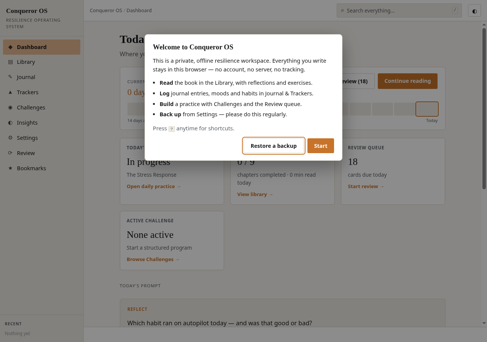
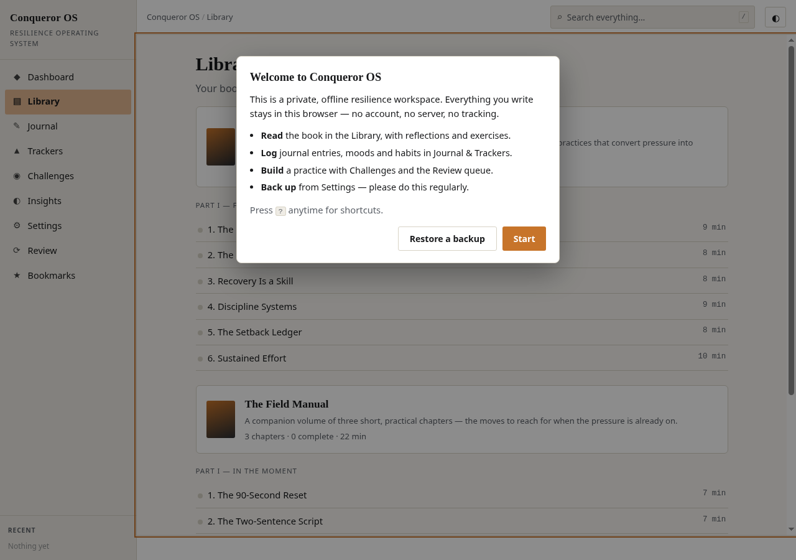
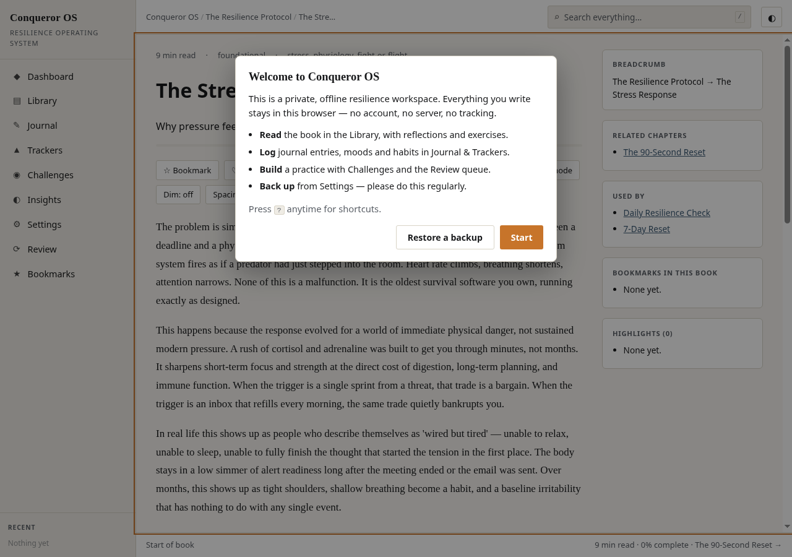

<!-- Banner — landing page: https://drsamonline.github.io/conqueror-os/ · demo: https://drsamonline.github.io/conqueror-os/play/ -->

<p align="center">
  <a href="https://drsamonline.github.io/conqueror-os/"></a>
</p>

<h1 align="center">Conqueror OS</h1>

<p align="center"><strong>A private, offline resilience workspace that lives in a single HTML file.</strong><br>
Read · reflect · journal · track · review — no server, no account, no build step required to run it.</p>

<p align="center">
  <a href="https://drsamonline.github.io/conqueror-os/"><strong>Landing page</strong></a>
  &nbsp;·&nbsp;
  <a href="https://drsamonline.github.io/conqueror-os/play/"><strong>Live demo</strong></a>
  &nbsp;·&nbsp;
  <a href="https://github.com/drsamonline/conqueror-os">Source</a>
  &nbsp;·&nbsp;
  <a href="docs/FEATURES.md">Features</a>
  &nbsp;·&nbsp;
  <a href="CHANGELOG.md">Changelog</a>
</p>

<p align="center">
  <a href="https://github.com/drsamonline/conqueror-os/releases"></a>
  <a href="https://github.com/drsamonline/conqueror-os/actions/workflows/ci.yml"></a>
  <a href="LICENSE"></a>
  <a href="https://github.com/drsamonline/conqueror-os/stargazers"></a>
  <a href="https://github.com/drsamonline/conqueror-os/commits/main"></a>
  <a href="https://github.com/drsamonline/conqueror-os/issues"></a>
</p>

---

<!-- Badges and links are configured for github.com/drsamonline/conqueror-os -->

[](https://github.com/drsamonline/conqueror-os/actions/workflows/ci.yml)
[](https://drsamonline.github.io/conqueror-os/play/)
[](https://github.com/drsamonline/conqueror-os/releases)
[](#copyright-and-licensing)
[](#copyright-and-licensing)
[](https://github.com/drsamonline/conqueror-os/stargazers)
[](https://github.com/drsamonline/conqueror-os/commits)
[](https://github.com/drsamonline/conqueror-os/issues)
[](#-zero-dependencies)
[](#privacy)
[](#-single-file-by-design)
[](CONTRIBUTING.md)
[](https://www.conventionalcommits.org)


**A private, offline resilience workspace that lives in a single HTML file.**
Read · reflect · journal · track · review — no server, no account, no build step required to run it.

Conqueror OS is a self-contained personal application for building mental resilience. It ships a short book (*The Resilience Protocol*), a Markdown journal, daily trackers, fillable worksheets, structured challenges, a spaced-repetition review queue, and local-only analytics — all wrapped in one file you can open from disk, email to yourself, or host anywhere.

<p align="center">
  
</p>

---

## Table of contents

- [Highlights](#highlights)
- [Screenshots](#screenshots)
- [Quick start](#quick-start)
- [Single-file by design](#-single-file-by-design)
- [Zero dependencies](#-zero-dependencies)
- [Features](#features)
- [Keyboard shortcuts](#keyboard-shortcuts)
- [Data & privacy](#privacy)
- [Building from source](#building-from-source)
- [Testing](#testing)
- [Browser support](#browser-support)
- [Project structure](#project-structure)
- [Documentation](#documentation)
- [Roadmap](#roadmap)
- [Contributing](#contributing)
- [License](#license)
- [Disclaimer](#disclaimer)

---

## Highlights

- **One file, zero infrastructure.** `dist/conqueror-os.html` is the entire application. Open it and it runs.
- **Offline by construction.** After the page loads there are no network requests at all — enforced with a Content-Security-Policy that forbids outbound connections.
- **Private by default.** Your journal, notes and moods never leave the device. No analytics, no telemetry, no accounts.
- **A real reading system.** Multi-book library with parts/chapters, inline highlights in three colours, notes, bookmarks, favourites, focus mode, read-aloud and dwell-time tracking.
- **A practice system, not just a reader.** Journal, trackers, worksheets, challenges, and a spaced-repetition review queue.
- **Resilient storage.** Schema migrations, undo on every destructive action, encrypted backups, JSON/Markdown/Word/CSV export, and an import that can merge instead of overwrite.
- **A real icon system.** A single inline SVG sprite (~50 symbols) drives the whole interface — crisp at any zoom, colour-matched to every theme.
- **Accessible.** Keyboard-first, focus-trapped dialogs, ARIA live regions, radiogroup semantics, high-contrast theme, and reduced-motion support.

## Screenshots

| Library (multi-book, parts) | Reader (highlights, notes, related) |
|---|---|
|  |  |

---

## Quick start

**Use it online (nothing to install):** **[drsamonline.github.io/conqueror-os](https://drsamonline.github.io/conqueror-os/play/)**

**Or run the file yourself (no tooling required):**

1. Download [`dist/conqueror-os.html`](dist/conqueror-os.html).
2. Open it **directly in a browser tab** (double-click it, or *File → Open*).
3. That's it — the app runs entirely in your browser.

> **Important:** open the file in a real browser tab. If you view it inside an in-app preview pane, an email client or a document viewer, JavaScript may be blocked and you'll see an empty shell. The app shows an explicit message when that happens.

**Run it locally with a server (optional, for install/PWA-style use):**

```bash
npm run serve     # serves the repo at http://localhost:8080
```

## ⚡ Single-file by design

Everything — HTML, CSS, JavaScript, and all book content — is inlined into one document. That gives you:

- Trivially portable: a single file to keep, copy, back up or host.
- No CDN, no bundler required at runtime, no supply-chain surface.
- Works from `file://`, a USB stick, a static host, or an intranet share.
- The readable source (`src/index.html`) is the same file, just unminified.

## 🪶 Zero dependencies

The **runtime has no dependencies** — no framework, no library, no external asset. The only `devDependencies` are for the maintainer toolchain (a minifier and a headless DOM for tests). `npm ls --prod` is empty by design.

---

## Features

### Reading
- **Multi-book library** with parts and chapters, progress pips and per-book completion.
- **Inline highlights** in amber / blue / green with per-highlight notes; click any highlight to edit or delete.
- **Selection quick-actions** — highlight, copy, or send the selection straight to a new journal entry.
- **Notes** per chapter with Markdown and `[[wiki links]]` to other chapters.
- **Bookmarks with labels**, a dedicated Bookmarks page, and a Favourite-quotes page.
- **Inline SVG diagrams** — a themed, hand-built diagram for every chapter, drawn to adapt to the current theme.
- **Focus mode**, line-spacing / width / font / weight controls, and **read-aloud** (Web Speech API).
- **Themes:** light, dark, sepia, high-contrast, OLED black, and Auto (follows the OS).
- **Resume banner** and dwell-time tracking (minutes per day and per chapter).

### Journal & reflection
- Six entry types, **tags**, and filters by **type, tag, date range and free text**.
- **Edit** entries, **draft autosave**, **voice dictation**, and a rotating daily prompt.
- **"On this day"** resurfacing of past entries.
- **Attachments** (images) stored in IndexedDB.

### Trackers & analytics
- Built-in trackers (mood, sleep, exercise, meditation, habits) plus **custom trackers**.
- **Trend line + 7-day moving average**, **calendar heatmap**, and **correlation** (Pearson r) between any two trackers.
- Local-only **insights** and printable / exportable reports.

### Challenges & review
- Structured 7/21/30/45/90-day programs plus **custom challenges**.
- **Pause/resume**, **reminders**, a **shareable progress card** (canvas → PNG).
- **Spaced repetition** (SM-2 lite) over each chapter's key idea and reflection.

### Worksheets & knowledge
- Reusable fillable sheets with saved history (Daily Check, Weekly Review, Setback Ledger).
- **Knowledge graph** of chapters, worksheets and challenges by shared concepts.
- **Glossary** auto-built from chapter tags.

### Data, safety & privacy
- **Undo** on every delete; **custom modals** instead of native `confirm()`.
- **Exports:** JSON backup, **encrypted backup** (AES-GCM + PBKDF2 via WebCrypto), Markdown, Word (.doc), CSV (trackers / journal / all).
- **Import** with **merge or replace** and validation.
- **Storage usage meter**, **PIN app lock**, **CSP**, and an **export-first guard** on erase.

See [`docs/FEATURES.md`](docs/FEATURES.md) for the full catalogue.

## Keyboard shortcuts

| Key | Action |
|---|---|
| `/` | Open search |
| `Ctrl` / `⌘` + `K` | Command palette |
| `?` | Shortcuts help |
| `g` then `d`/`l`/`j`/`t`/`c`/`i`/`b`/`r`/`g`/`s` | Go to Dashboard / Library / Journal / Trackers / Challenges / Insights / Bookmarks / Review / Glossary / Settings |
| `←` / `→` | Previous / next chapter (in reader) |
| `b` / `f` / `h` / `r` | Bookmark / favourite / highlight / read-aloud (in reader) |
| `Esc` | Close overlay / exit focus mode |

## Privacy

Conqueror OS makes **no network requests** after the page loads. All data is stored in your browser's `localStorage` (and IndexedDB for attachments) on your device only. There is no backend, no analytics and no tracking, and the shipped Content-Security-Policy sets `connect-src 'none'` to make outbound requests impossible. See [`docs/PRIVACY.md`](docs/PRIVACY.md).

## Building from source

Requires Node.js 18+.

```bash
npm install         # installs the dev toolchain only
npm run build       # minifies src/index.html -> dist/conqueror-os.html
npm test            # runs the headless DOM smoke suite
```

- **Source of truth:** [`src/index.html`](src/index.html) (readable).
- **Build output:** [`dist/conqueror-os.html`](dist/conqueror-os.html) (minified, the file users open).

## Testing

The smoke suite (`tests/smoke.test.js`) drives the real application in a headless DOM and asserts **30 checks** across every route, persistence path and interaction — plus a regression guard for the bugs fixed during the audit. Continuous integration runs the suite and the build on every push and pull request (see [`.github/workflows/ci.yml`](.github/workflows/ci.yml)).

The project was additionally verified in real headless Chromium (22 checks, zero console errors) during development.

## Browser support

Modern evergreen browsers from **~2019 onward**: Chrome 73+, Edge 79+, Firefox 62+, Safari 12+.
The code uses ES2019 features (arrow functions, template literals, `String.prototype.padStart`, `Array.prototype.flat`) and no transpilation is required.

## Project structure

```
conqueror-os/
├── index.html                  # GitHub Pages entry point (same as dist/)
├── src/index.html              # readable source (the whole app)
├── dist/conqueror-os.html      # built, minified, single-file app
├── scripts/build.js            # minify src -> dist
├── scripts/serve.js            # tiny local static server
├── tests/smoke.test.js         # headless DOM smoke suite
├── docs/                       # architecture, features, audit, privacy, roadmap
├── .github/                    # CI, issue/PR templates, dependabot
├── README.md
├── CHANGELOG.md
├── CONTRIBUTING.md
├── CODE_OF_CONDUCT.md
├── SECURITY.md
└── LICENSE
```

## Documentation

| Document | Contents |
|---|---|
| [`docs/ARCHITECTURE.md`](docs/ARCHITECTURE.md) | How the single-file app is put together |
| [`docs/FEATURES.md`](docs/FEATURES.md) | Complete feature reference |
| [`docs/AUDIT.md`](docs/AUDIT.md) | Code audit, fixes, compression and enhancement catalogue |
| [`docs/PRIVACY.md`](docs/PRIVACY.md) | Data handling and storage model |
| [`docs/ROADMAP.md`](docs/ROADMAP.md) | Planned and deliberately deferred work |
| [`CHANGELOG.md`](CHANGELOG.md) | Version history |

## Roadmap

See [`docs/ROADMAP.md`](docs/ROADMAP.md). Near-term themes: an optional service worker for installable use (when served over HTTP), Hindi/Gujarati localisation, and optional end-to-end sync via an export file.

## Contributing

Contributions are welcome — please read [`CONTRIBUTING.md`](CONTRIBUTING.md) and the [`CODE_OF_CONDUCT.md`](CODE_OF_CONDUCT.md). Commit messages follow [Conventional Commits](https://www.conventionalcommits.org).

## Copyright and licensing

**© 2026 Dr Sohil Momin. All rights reserved.**

This project contains two different kinds of work, licensed separately:

| | What it covers | Licence |
|---|---|---|
| **Software** | The HTML, CSS and JavaScript that make up the application | [MIT](LICENSE) — free to use, modify and redistribute |
| **Written content** | The books, chapter text, reflections, exercises, prompts, worksheet and challenge copy, and the application's written interface text | [Content licence](CONTENT-LICENSE.md) — **© all rights reserved** |

The written content is an **original work of authorship**. It is protected by
copyright and is **not** covered by the MIT licence: it may be read and used for
personal, non-commercial purposes, and short excerpts may be quoted with
attribution, but it may not be reproduced, adapted, redistributed, used
commercially, or used to train machine-learning models without written
permission. See [`CONTENT-LICENSE.md`](CONTENT-LICENSE.md) for the full terms.

For permission requests: **sohilmomin2000@gmail.com**

## Disclaimer

Conqueror OS is a self-help and reflection tool. It is **not** a medical device and does not provide medical or psychological diagnosis or treatment. If you are struggling with your mental health, please speak to a qualified professional.
